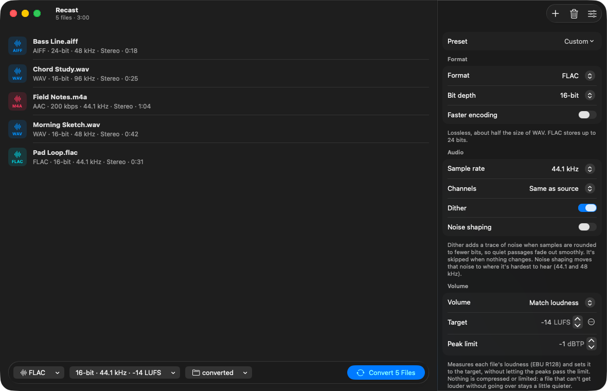
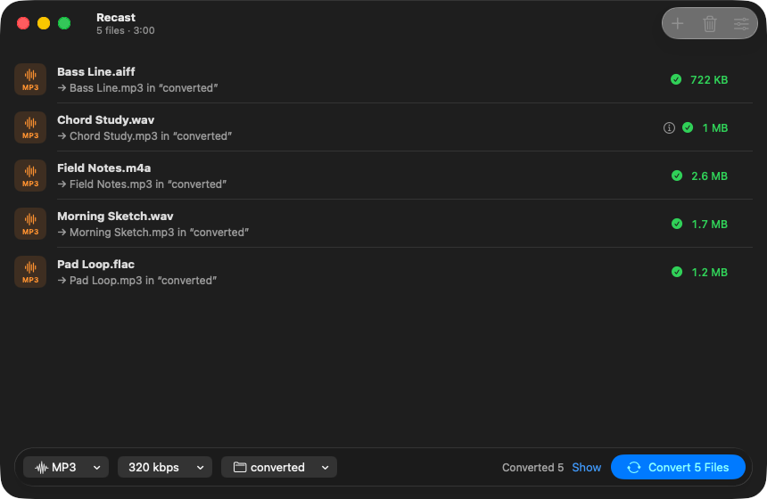

# Recast

A macOS app (SwiftUI, Liquid Glass) for converting audio files. Drop files or whole folders on the window
(or the Dock icon), pick a format, press **Convert**. Everything else is optional.

- **Bottom bar**: the format, a quality menu with the usual choices for that format, and where the files go
  (**Next to Originals** or a folder, with recent folders, "keep folder structure" and what to do when a file
  already exists). **Convert** converts every file in the list; **Stop** ends a batch (⌘.).
- **Settings** (toolbar button or ⌥⌘I) holds the rest, grouped: format options, sample rate, channels,
  dither, volume, tags, output folder and file-name pattern. **Preset** at the top applies a built-in or saved
  preset, or saves the current settings (format and sound only; where files go stays as it is).
- Each row shows the file's format, bit depth, rate, channels and length. After converting it shows the new
  file and its size; an ⓘ lists anything worth knowing (resampled because the format required it, level
  changes, clipping). Right-click a row to show or play the converted file.
- Up to eight files convert at once. Originals are never changed or replaced: output goes to a hidden temporary
  file next to its destination and is moved into place when finished; a name that would replace an original
  or another file in the batch gets a number ("Song 2.mp3").

<picture>
  <source media="(prefers-color-scheme: light)" srcset="docs/screenshots/settings.png">
  
</picture>

<picture>
  <source media="(prefers-color-scheme: light)" srcset="docs/screenshots/converted.png">
  
</picture>

*Screenshots made with Recast's snapshot mode and generated test tones (see Tests); GitHub shows the light or dark
set to match your theme.*

Recast's own code is open source under the GNU General Public License, version 3 or later (`LICENSE`).
Copyright (C) 2026 omso. The bundled encoders keep their own licences: LAME 3.100 is under the GNU LGPL
version 2 (`Sources/CLame/COPYING`), and libogg and libvorbis are under Xiph.Org's BSD-style licence
(`Sources/COggVorbis/libvorbis-1.3.7/COPYING`). See Known limits for what the LGPL asks before a built app
is shared.

## Formats

| Format | Written by | Options | Tags written |
| --- | --- | --- | --- |
| WAV | Core Audio | 16, 24, 32-bit, 32-bit float; RF64 above 4 GB | LIST/INFO and an ID3v2.3 chunk (cover art) |
| AIFF | Core Audio | 16, 24, 32-bit; 32-bit float as AIFF-C | name/author/copyright/annotation and an ID3v2.3 chunk (cover art) |
| FLAC | Core Audio | 16, 24-bit; faster or smaller | Vorbis comments and a picture block |
| Apple Lossless (.m4a) | Core Audio | 16, 24, 32-bit | iTunes tags and cover art |
| CAF | Core Audio | 16, 24, 32-bit, 32-bit float | Core Audio's info chunk (no cover art) |
| MP3 | LAME 3.100 | constant, average or variable bit rate (V0–V9), joint stereo | ID3v2.4 with cover art; LAME/Xing header for length and gapless playback |
| AAC (.m4a) | Core Audio | AAC-LC or HE-AAC; constant, average, constrained-variable or variable (quality) | iTunes tags and cover art |
| Ogg Vorbis | libvorbis 1.3.7 | quality −1 to 10, or average bit rate | Vorbis comments, cover art as METADATA_BLOCK_PICTURE |
| Opus (.opus) | Core Audio's Opus encoder, Ogg pages by libogg | 6–510 kbps | OpusTags, cover art as METADATA_BLOCK_PICTURE |

Anything macOS can decode can be converted: WAV/BWF/RF64/Wave64, AIFF, CAF, FLAC, Apple Lossless, MP3, MP2,
AAC/HE-AAC, Ogg Vorbis, Opus, AC-3/E-AC-3, AMR, Sound Designer II, µ-law and A-law. Tags are read from ID3v2.2–2.4
and ID3v1, Vorbis comments (FLAC, Ogg), iTunes MP4 tags, WAV INFO/ID3 chunks, AIFF text/ID3 chunks and CAF info.
The common fields carry across (title, artist, album, album artist, composer, genre, date, track and disc
numbers, comment, lyrics, copyright, ISRC, grouping, BPM, compilation, cover art) plus any other text tags
(MusicBrainz IDs, ReplayGain…). ReplayGain and iTunNORM values are dropped when Recast changes the level.

### Sound

- **Sample rate**: Core Audio's mastering-quality converter. Formats with fixed rates (MP3, AAC, Vorbis up to
  48 kHz; Opus always 48 kHz) use the closest allowed rate of the same family (88.2 kHz → 44.1 kHz) and say so.
- **Channels**: same as source, mono (average) or stereo. Surround is mixed down with ITU levels (centre and
  surrounds at −3 dB, LFE left out) assuming WAV channel order. MP3, AAC and Opus hold two channels at most.
- **Bit depth**: rounding to fewer bits uses TPDF dither (optionally with 3-tap noise shaping at 44.1/48 kHz).
  Dither is skipped when nothing changes, so a 16-bit WAV → FLAC → WAV round trip is bit-exact.
- **Volume**: match loudness (EBU R128 / ITU-R BS.1770-4, measured on the converted signal) with a true-peak limit,
  normalize sample peaks, or a fixed change. It is gain only: no compressor or limiter. A file that can't reach
  the loudness target without passing the peak limit stays quieter, and the row says by how much.

## Build and run

```sh
./build.sh                       # builds build/Recast.app (ad-hoc signed, local use)
open build/Recast.app
```

Requires macOS 26 (Liquid Glass) and Xcode 26 or newer; the script uses Xcode's toolchain. The icon is drawn by
`icon/make_icon.swift`; run `icon/make-icns.sh` to rebuild `Resources/AppIcon.icns`.

### With omso Builder

The repository describes its build in `omso-build.json`: `build.sh`, the engine tests (`test.sh`), then
`Recast --self-test`, which converts a generated, tagged 24-bit file to every format and checks lengths, tags,
cover art, bit-exact lossless audio and loudness matching. **Build & Install** copies `Recast.app` into
`/Applications/omso`.

Command line (same engine, no window):

```sh
build/Recast.app/Contents/MacOS/Recast --convert FILE|FOLDER… --format mp3 [--out FOLDER] [--bitrate 320] …
build/Recast.app/Contents/MacOS/Recast --convert ~/Music/Album --preset podcast --out ~/Desktop/Episodes
build/Recast.app/Contents/MacOS/Recast --info FILE…        # format, loudness, true peak and tags
build/Recast.app/Contents/MacOS/Recast --self-test FOLDER
build/Recast.app/Contents/MacOS/Recast --help              # every option
```

## Tests

```sh
./test.sh                        # xcrun swift test with Xcode's toolchain; extra arguments are passed on
```

The tests generate their own audio in temporary folders (deleted afterwards; `RECAST_KEEP_TEST_FILES=1` keeps
them) and check: bit-exact lossless round trips in every lossless format, dither noise levels, compressed formats
against the source (correlation and alignment), resampling, channel mixing, loudness measurement against the
BS.1770 reference tone and normalization, clipping reports, tags and cover art through every format, M4A chunk
offsets when large cover art moves the audio, very short files, file naming and collisions, and settings storage.

Screens can be captured without clicking: `RECAST_SNAPSHOT=/tmp/shots RECAST_FILES=a.wav:b.flac` launches the
app, saves PNGs of the main states (light, dark, minimum size), converts copies into `/tmp/shots/converted` and
quits. Launch it from a terminal that has Screen Recording permission; the window may look inactive in the
captures because the app starts in the background.

## Known limits

- Decoding is Core Audio's: WMA, APE, WavPack, DSD and Matroska/WebM files aren't read.
- Core Audio's FLAC encoder offers two speeds rather than levels 0–8. It writes a broken file for audio shorter
  than one FLAC block (4608 samples, about 0.1 s), so Recast writes those itself as one uncompressed FLAC frame;
  files under 16 samples are valid FLAC but macOS can't open them.
- When macOS decodes Ogg Vorbis written by Recast, the audio comes out 128 samples (3 ms) early. The files come
  straight from libvorbis; other players haven't been checked.
- CAF files get no cover art (Core Audio's info chunk has no field for it). WAV tags are skipped for RF64 files.
- LAME is linked statically, which is fine for local use. Before distributing Recast, build LAME as a separate
  dynamic library (as omso DAW does) to meet the LGPL, and include its licence and source.

## Layout

```text
Sources/RecastCore/         engine, no UI
  Model.swift               formats, settings, presets
  QualityChoices.swift      the quick quality menu for each format
  Probe.swift               reading file details; decoding and resampling (ExtAudioFile)
  DSP.swift                 channel mixing, dither and noise shaping
  Loudness.swift            BS.1770 loudness, sample and true peak
  Converter.swift           one file: plan, analyse, encode, tag, move into place
  OutputPlanner.swift       output names and folders, collisions, folder scanning
  Encoders/                 Core Audio, FLAC (short-file fallback), LAME MP3, libvorbis and Opus-in-Ogg
  Tags/                     ID3, Vorbis comments/FLAC, MP4, WAV/AIFF chunks
Sources/CLame/              LAME 3.100 encoder, vendored unmodified (see OMSO_PROVENANCE.md)
Sources/COggVorbis/         libogg + libvorbis 1.3.7 as bundled with JUCE (see OMSO_PROVENANCE.md)
Sources/Recast/             SwiftUI app: list, bar, settings, command line, self-test, snapshots
Tests/RecastCoreTests/      generated fixtures and engine tests
```
